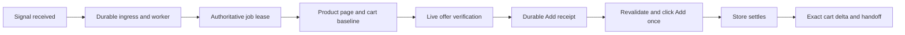

# Signal-to-cart latency audit · 2026-09-05

The measured empty-style optimization has since been implemented. See the [implementation receipt](CART_LATENCY_IMPLEMENTATION_2026-09-05.md) for current adapter versions and validation. The measurements below retain the original pre-implementation audit evidence. The benchmark now compares the packaged optimization with an in-memory reference restoring the previous algorithm.

Yoink can reduce the work between a stock signal and Add without making the user inspect the product again. The current executor already reuses store qualification and recent cart baselines. Its largest measured local opportunity is repeated page visibility scanning; the next opportunities are reaching a usable product page sooner and preparing the exact product context ahead of a signal.

This audit tests the working 1.22.6 code, including the existing Best Buy changes, on top of commit `23428e5`. The experiment changes generated code only in memory. It does not change the installed companion, activate a store, or submit a real retailer action.

## What the timings mean

Distinguish **signal-to-click**, which matters for stock competition, from **signal-to-verified-cart**, which matters for the user's handoff. A completed click is not proof that the store accepted an item. Checkout remains manual.



The local database snapshot contains **148 jobs, all notification-only**, and no completed Add/cart phase evidence. It cannot establish a live per-store signal-to-click or signal-to-cart average. The 185 processed signal inbox records have a historical receive-to-processed median of **1,073 ms**, p95 **1,878 ms**, maximum **1,948 ms**. That is historical queue/processing time, not a newly measured benchmark or proof that a polling interval caused the delay. All 182 non-test signal rows have identical observed and received timestamps; these rows cannot measure upstream detection/push transport time.

The snapshot has qualification rows for Target, Walmart and Amazon, and none for Best Buy. Qualification rows alone do not prove that a lane can currently execute: exact adapter/pack versions, degradation, session, user settings and lease policy still apply.

## Measured browser work

The reproducible [benchmark](../scripts/benchmark-cart-latency.mjs) measures preparation through the fixture Add click in headless Chromium. It uses each store's actual packaged runner, confirms that its source builds to the same bytes, and compares an in-memory prototype. Every network request is intercepted, every document is a checked-in fixture, and clicks have no external effect.

Each timing cell uses 5 warmups and 20 measured iterations, with nearest-rank p50/p95. Small fixtures contain only the commerce markup. The large cases append 3,000 recommendation containers with two text spans each, bringing the page to roughly 9,000 elements. These deliberately expose scaling cost; they are not representative live retailer page captures. There is no CPU/network throttling or selector-call instrumentation. Baseline/prototype order alternates by store; each case has a new context. Shared-host load and small sample sizes limit fine-grained comparisons.

Large-fixture **preparation + final checks + fixture click** (milliseconds):

| Store | Current p50 | Prototype p50 | Current p95 | Prototype p95 | p50 reduction |
| --- | ---: | ---: | ---: | ---: | ---: |
| Target | 1,357.1 | 515.8 | 1,556.4 | 680.7 | 62.0% |
| Walmart | 1,526.4 | 336.3 | 1,615.6 | 366.9 | 78.0% |
| Amazon | 1,537.7 | 319.9 | 1,607.9 | 616.5 | 79.2% |
| Best Buy | 3,004.7 | 1,550.7 | 4,727.8 | 1,973.6 | 48.4% |

Small-fixture p50:

| Store | Current | Prototype |
| --- | ---: | ---: |
| Target | 2.1 ms | 1.3 ms |
| Walmart | 2.9 ms | 1.2 ms |
| Amazon | 4.3 ms | 1.5 ms |
| Best Buy | 16.7 ms | 4.1 ms |

Chromium 145.0.7632.6; **16 timing cells / 320 measured iterations / 88 scenario cases passed**. [Raw measurements and hashes](evidence/cart-latency-2026-09-05.json).

Best Buy Shipping-selection fixtures completed in 237 ms with current code and 229 ms with the prototype, including the 200 ms quiet period. Both no-update fixtures rejected selection after approximately 406 ms using the test-only 400 ms timeout. These single scenario samples establish behavior, not a statistically measured selection speedup.

The large-fixture median saving is roughly **0.84 seconds for Target, 1.19 seconds for Walmart, 1.22 seconds for Amazon and 1.45 seconds for Best Buy**. These are CPU-stage savings in controlled fixtures, not measured reductions in live signal-to-cart time. Best Buy still spends about 1.55 seconds in this stage on the large fixture, leaving further scan consolidation worth investigating.

### The tested optimization

Both `target.ts` and `retailers.ts` normalize each ancestor's inline `style` attribute with `toLocaleLowerCase("en-US")` inside their visibility helper. Whole-page text walks repeatedly call this helper. Most elements have no inline style, yet the locale operation still runs on an empty string.

The prototype checks whether the style attribute is empty first. It retains the exact existing normalization for nonempty attributes, and retains computed-style checks where the current adapter uses them. It changes no selectors, fulfillment rules, security checks, offer validation or click authorization. It caches no observation or decision. That makes this a useful first optimization before attempting more complex cached inspection results.

There is further repeated work: each store's preparation observes the offer and binds its control; commit re-observes and rebinds. Target also observes again after its optional fulfillment selection, including when no selection was necessary. Security and interactive-block checks walk body text repeatedly. A later optimization can share immutable results **within a synchronous read pass**, then discard them before any await, fulfillment click or fresh final pass. An old inspection must never become a reusable click authorization.

## Scenarios exercised for every store

The Chromium harness runs both current and prototype bundles through the following cases and asserts the actual number of fixture Add clicks:

| Case | Required result |
| --- | --- |
| Unchanged first-party Shipping offer | One Add click after preparation |
| Prior successful no-click rehearsal | Rehearsal clicks nothing; a fresh preparation/commit can click once |
| Price rises above the saved limit after preparation | Zero Add clicks |
| Seller changes to marketplace after preparation | Zero Add clicks |
| Add element is replaced by an identical-looking element | Zero Add clicks |
| Add becomes disabled | Zero Add clicks |
| Human-verification challenge appears | Zero Add clicks |
| Ancestor gets `DISPLAY: none` | Zero Add clicks; nonempty style handling is preserved |
| Prepared authorization becomes older than 10 seconds | Zero Add clicks |
| Same authorization is committed twice | First commit clicks once; second commit is rejected |

Amazon additionally changes its page-local offer token after preparation and must reject the Add. Best Buy additionally changes Shipping to Pickup after preparation, selects Shipping successfully without Add, and times out a Shipping control that does not update without Add. The selection fixture uses an immediate page update and the existing quiet period; it is not a measurement of Best Buy's real fulfillment API.

The tests support reusing prior **knowledge** to prepare a faster path. They also show why prior price, seller, fulfillment or Add binding cannot be trusted as the current purchase decision.

## What is already optimized

- Push ingress and the bounded job watch begin concurrently. General health/heartbeat requests are not placed before each lease. A 25-second long poll is a maximum wait for an absent job, not a mandatory delay before every job.
- The embedded worker has an immediate wake path, coalescing wakes received during an active cycle. The availability pulse wakes the job watch when work appears. The external worker uses a separate polling process, so embedded wake behavior must not be assumed for that deployment.
- Cold product loading and read-only cart baseline capture run concurrently. The product need not wait for an entire serial cart round trip before it starts loading.
- Recent exact cart inventory can be reused for five minutes, under the existing retailer/contract/age/tab and cart-delta rules. Warm readiness rotates through two stores per cycle beneath action priority. User handoff tabs are protected from reuse.
- Read-only browser work overlaps progress acknowledgements. Successful diagnostics are best-effort background work. The durable `adding` receipt still completes before Add.
- Cart hydration uses mutation-triggered rechecks with a 60 ms quiet interval and a 250 ms fallback. Baseline/proof ceilings are limits on unavailable evidence, not unconditional sleeps.
- A verified cart handoff reaches the user before completion telemetry finishes posting.

Relevant implementation: [executor and scheduling](../apps/extension/background.js), [availability pulse](../apps/api/src/action-job-availability.ts), [worker wake](../packages/engine/src/background-worker-runtime.ts), [qualification](../packages/database/src/qualification-repository.ts).

## Recommended flow per store

| Store | Prepare before the signal | At the signal | Store-specific boundary |
| --- | --- | --- | --- |
| Target | Current qualification, chosen Shipping/Pickup, recent baseline; retain exact layout hints | Lease, fresh selected-offer read, durable receipt, final validation and Add | Re-read after a fulfillment-selection click; an unchanged synchronous Shipping pass may be consolidated only after proving equivalence |
| Walmart | Current qualification, explicit first-party offer and saved fulfillment, recent baseline | Same shared path; prefer a warm exact product context when available | Recheck seller/price/fulfillment and exact Add binding; a previous Shipping observation cannot authorize Pickup |
| Amazon | Current qualification, signed-in readiness where needed, exact ASIN context and baseline | Rebind current first-party offer, then receipt and final Add | Keep the offer token in page memory; token changes invalidate preparation |
| Best Buy | Resolve numeric SKU, current qualification, select saved Shipping before the signal when possible | Verify selected Shipping, fresh price/seller, then receipt and final Add | Product codes require exact SKU evidence; failed Shipping selection stops; Buy Now and accessories are excluded |

The existing Inspect workflow makes one observation and one no-click rehearsal. These serve different purposes: reading page evidence and proving that the action adapter reaches its final boundary. Store qualification normally lasts up to 30 days but is invalidated by version/pack changes, expiry or current failures. Automatic renewal can refresh a previously authorized lane; it does not authorize a new lane. The popup's “Inspect again” option is a deliberate diagnostic action, not evidence that each incoming signal must wait for a user inspection.

A future prepared product context should be keyed by store, exact SKU, adapter/pack version, device/session, document identity and saved plan revision. Reuse layout/control-location hints, routing and selected fulfillment to avoid rediscovery. Invalidate on navigation, relevant DOM changes, sign-out/challenge, plan edits, version changes or expiry. A new lease still checks current spend, quantity, expiry and competing work; a fresh live pass still checks the current offer. Keep the one-use Add authorization short lived.

## Optimization order

| Priority | Change | Evidence and expected scope |
| --- | --- | --- |
| 1 | Ship the empty-style fast path after normal adapter release validation | Measured in this audit; reduces local pre-click CPU without reusing stale evidence |
| 2 | Consolidate repeated visibility/text/offer work within one synchronous pass | Source shows repeated scans; benefit remains unmeasured beyond the tested fast path. Invalidate across asynchronous boundaries and selection |
| 3 | Probe exact product readiness before the whole tab reaches `complete` | Current `waitForTab` waits for all load completion. Can avoid waiting on unrelated resources, but must require exact identity, complete offer/security evidence and a short stable period; timing benefit needs real-page measurement |
| 4 | Maintain a bounded warm exact product context for high-priority watched plans | Current warm readiness warms carts, not every product. Could eliminate product navigation for a usable existing context; needs memory/tab budgets, invalidation and realistic page acceptance |
| 5 | Measure external-worker wake and long-poll coverage gaps | Default external worker polling is 2 seconds; job-watch fallback is 1 second, temporarily 250 ms after ingress. The 25-second watch on a 30-second alarm can leave a nominal 5-second gap for server-originated events. Do not lower all timers blindly |
| 6 | Replace generic post-click settling only when exact cart evidence is ready | Current settle races navigation with a DOM quiet period and a 1.5-second timeout. This affects verified-cart handoff, not the already-issued click. Exact cart delta must remain authoritative |

Potential navigation, scheduling and settlement savings are not additive to the measured CPU savings and have not been demonstrated on live stores. The cold path already overlaps product/cart loading; the relevant duration is the slower branch plus required checks, not the sum of both loads.

## Acceptance for a production optimization

Record signal receipt, durable processing/job creation, lease, product readiness, baseline readiness, offer preparation, receipt acknowledgement, click and exact cart proof. Existing phase telemetry covers much of this; product navigation versus scanning and receipt versus final revalidation need finer separation. Report signal-to-click and signal-to-verified-cart p50/p95 separately for store, warm/cold context and fulfillment changes. Do not include page tokens, raw DOM or personal data.

Before claiming a store speedup, compare representative promoted captures and installed Chrome scenarios: stable offer, cold cart, warm baseline, slow hydration, same-document offer change, challenge, fulfillment switch and lost acknowledgement. Include competing jobs, policy edits and stale baselines. The normal adapter process requires affected contract version bumps, rebuilt/packaged companion, selector/capsule replay and fresh qualification. A shared adapter change can affect observers beyond the four Add lanes; account for that scope during implementation.

## Reproduce and validation

```sh
node --import tsx scripts/benchmark-cart-latency.mjs /tmp/yoink-cart-latency.json
```

Install the repository dependencies and Playwright Chromium first. `YOINK_TEST_CHROME` optionally selects an existing Chromium executable. The benchmark fails if packaged runners differ from current source, if a scenario violates its expected outcome, or if an unexpected fixture action occurs. JSON is checkpointed after each timing cell and scenario group, with a final pass/fail status and bundle/fixture hashes. It intentionally asserts behavior rather than a machine-dependent millisecond threshold.

Final validation passed:

- The Chromium benchmark exited 0: 16 timing cells, 320 measured iterations and 88 scenario cases across current/prototype runners. Raw evidence has `status: "passed"`.
- All **226 regression tests** passed across the four Add runners, retailer observers, extension runtime, job availability pulse, worker runtime and latency analytics. Runtime coverage includes all-store push-to-Add orchestration, cold concurrent product/cart loading, read-only work overlapping acknowledgements, warm readiness and recovery, and diagnostics staying outside the critical path. These runtime tests mock Chrome/server behavior and do not establish real network timing.
- `npm run check` passed, including TypeScript, UI-token and selector-pack checks. `npm run build:types` passed. The benchmark separately built and byte-compared all four packaged Add runners without modifying release files.
- `node --check scripts/benchmark-cart-latency.mjs` passed. Every pre-existing modified/untracked file retained its starting SHA-256. The audit adds only this report, its JSON evidence and the benchmark script.

Regression command:

```sh
node --import tsx --test --test-concurrency=2 \
  test/target-action.test.ts test/walmart-action.test.ts \
  test/amazon-action.test.ts test/bestbuy-action.test.ts \
  test/retailer-adapters.test.ts test/action-job-availability.test.ts \
  test/background-worker-runtime.test.ts test/extension-runtime.test.ts \
  test/admin-analytics-repository.test.ts
```

The full application/PostgreSQL suite and live installed-companion release acceptance were not rerun for this research-only change. No production speedup or real retailer cart completion is claimed.
